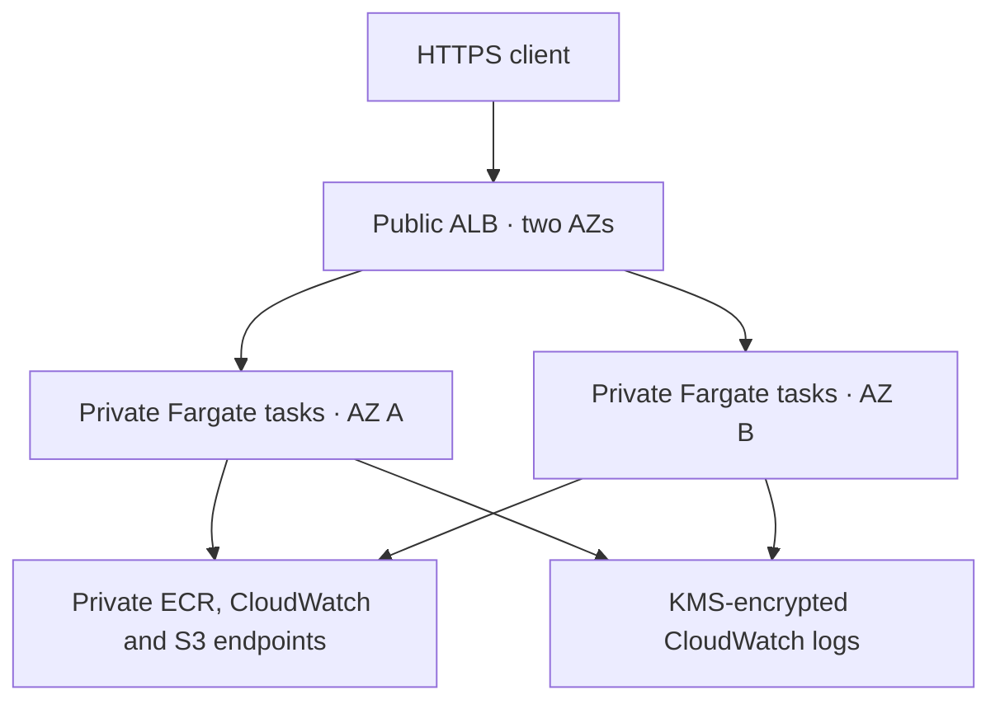

# Terraform AWS HA Platform

A modular, deployment-oriented AWS foundation for a stateless web service: HTTPS
ALB, private Fargate tasks across two AZs, private AWS endpoints, per-AZ NAT, encrypted logs, alarms, and
isolated remote Terraform state. It includes a DevSecOps CI pipeline and a saved-plan
CD workflow. This is a personal engineering project, not an employer system.

## Structure

- `modules/network` — VPC, public/private subnets, one NAT per AZ, routes, flow logs.
- `modules/service` — HTTPS ALB, least-exposure security groups, private ECS tasks,
  deployment circuit breaker, immutable image requirement, access logs and alarms.
- `modules/telemetry` — rotating regional CloudWatch KMS key with scoped log access.
- `modules/state-backend` — protected S3 bucket, versioning, KMS, public-access block.
- `bootstrap` — separately owned state foundation.
- `environments/dev` and `environments/production` — independent roots and state keys.
- `scripts` — repeatable checks and a destructive-change policy.

## Architecture



AZ rebalancing and multiple tasks provide a regional HA design. No fixed uptime
percentage, AZ failover test, multi-region recovery, or production readiness is
claimed without deployment evidence. The sample workload is stateless; persistent
application data needs its own HA/backup/recovery design.

## Validate without provisioning

Terraform 1.10.5, Python 3.12, and Docker for the security scanners:

```bash
bash scripts/checks.sh
```

Mocked-provider tests execute configuration behavior without AWS API calls.
They do not prove cloud provisioning or failure recovery. See [validation](docs/validation.md).

## State and deployment

Read [state management](docs/state-management.md), [deployment](docs/deployment.md),
and [operations](docs/operations.md) before applying. Supply your real account,
region, two AZs, an issued ACM certificate, a confirmed SNS alert topic, globally
unique bucket names, and an image digest. Example values are intentionally placeholders.
The container must run as uid 101, listen on 8080, and work with read-only root
and a writable `/tmp`. Create and scan your real image separately; this repository
manages infrastructure and does not pretend to build an application it does not own.

**AWS apply incurs charges** for NAT gateways, ALB, Fargate, logs, KMS, and storage.
No deployment is automatic on merge. Production CD cannot be considered gated until
GitHub environment protection and OIDC trust policies are actually configured.

## CI and CD

CI: formatting → every-module validation → mocked behavior tests → secret scan →
HIGH/CRITICAL IaC security gate. Jobs fail on findings; failures must be investigated.

CD: manual main-branch dispatch → repeat contracts/security → AWS OIDC plan role →
S3 state lock → no-delete policy → saved plan + digest → protected environment
approval → AWS OIDC apply role → exact saved-plan apply → ECS service stability.
The workflow is infrastructure CD; it does not claim application smoke, DAST, or
container scanning. Add those in the application's build/release repository and
promote only its scanned digest here.

## Production adoption decisions

Before a production deployment: use separate AWS accounts, configure restrictive
OIDC roles and reviewers, pin Actions/images by verified digest/SHA, establish
WAF/rate limits where required, add application SLO and synthetic monitoring,
confirm notification delivery, run task/AZ failure and state-restore drills,
review endpoint/NAT costs and approved egress, and approve a retention policy. The
provided modules are a baseline, not a claim those organizational controls exist.

See [security decisions](docs/security-decisions.md) for scoped, expiring scanner exceptions and the restricted private-endpoint egress model.

## Verified CI results

[All four CI jobs passed](https://github.com/hdevops9-ops/aws-eks-platform/actions/runs/42451162317): provider-aware validation, six mocked Terraform behavior tests, four destructive-plan policy tests, Gitleaks, the scoped Trivy security gate, and Actionlint. See [validation evidence](docs/validation.md). AWS OIDC deployment and HA/state recovery remain sandbox acceptance tests, not claimed results.
